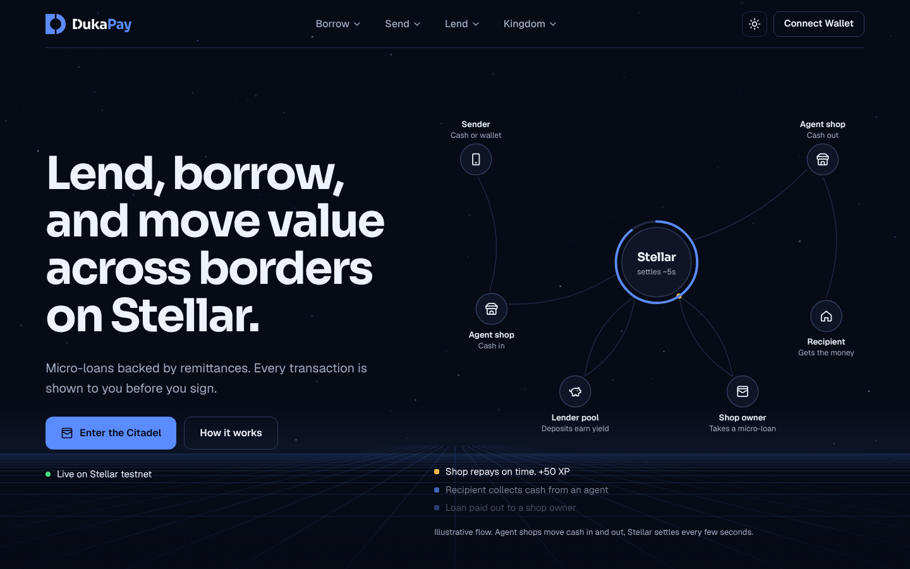
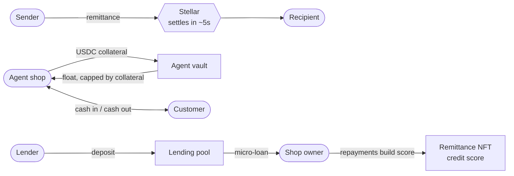
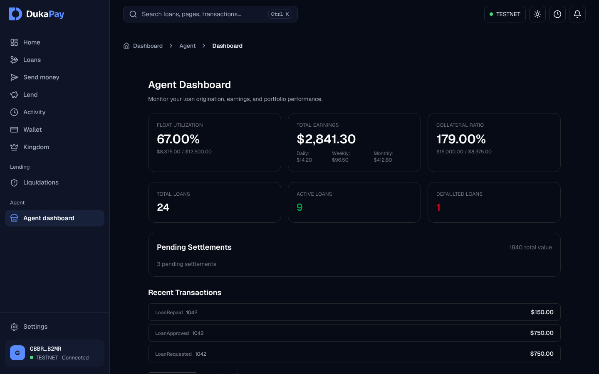
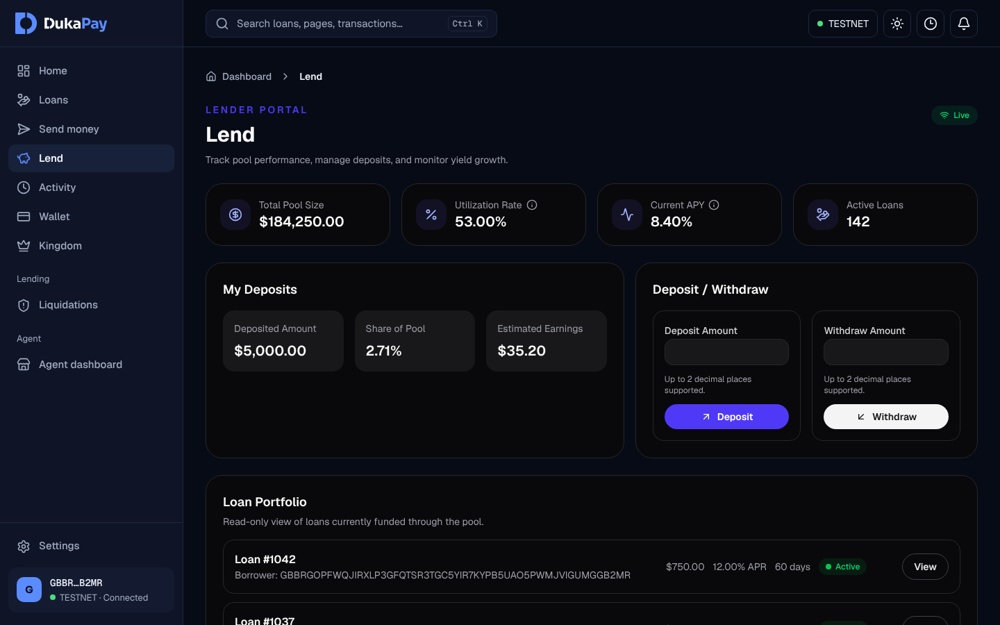
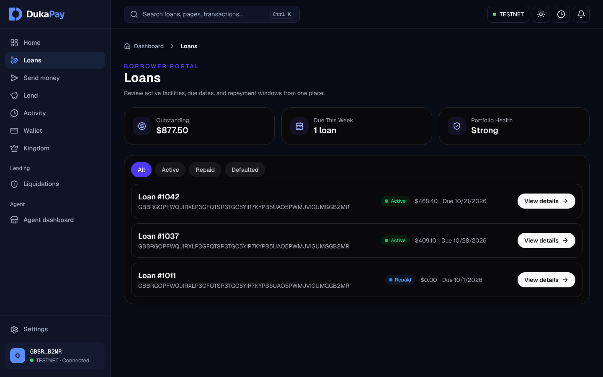

<div align="center">

<picture>
  <source media="(prefers-color-scheme: dark)" srcset="frontend/public/brand/dukapay-logo-dark-tagline.svg">
  
</picture>

<br><br>

**Turn the corner shop into a bank branch.**<br>
Stablecoin cash-in, cash-out and micro-loans through local agents, with solvency enforced on Stellar.

<br>

[](https://stellar.org)
[](docs/deployed-contracts.md)
[](SECURITY.md)
[](LICENSE)
[](CONTRIBUTING.md)

[How it works](#how-it-works) · [Architecture](#architecture) · [Quick start](#quick-start) · [Contributing](#contributing) · [Roadmap](#roadmap)

</div>

---

> [!WARNING]
> DukaPay runs on **Stellar testnet only** and has **not been audited**. Don't use it with real funds.

## Why DukaPay

Hundreds of millions of people in Africa still live in cash. Mobile money reaches them through **agents**, the shop owners who swap cash for e-money and back. That agent layer is the real last-mile financial network, but today it runs on private books: float is siloed, nobody can check an agent's solvency, and settlement lags.

A stablecoin is useless in a cash economy without a place to cash in and out. DukaPay ("duka" means shop in Swahili) is that network, built as open, auditable infrastructure on Stellar:

- **Agents** lock USDC collateral and issue float against it. The contract enforces the solvency rule, so it's checked on every action instead of promised.
- **Senders** move money across borders, and **recipients** collect cash from a nearby agent.
- **Shop owners** borrow micro-loans backed by their remittance history and on-chain credit score.
- **Lenders** fund those loans from a shared pool and earn yield.

<div align="center">
  
</div>

## How it works



**The solvency rule.** Across the network, issued float can never exceed collateral after the haircut:

```
Σ float ≤ Σ collateral × haircut
```

`agent_vault` checks this on every mint, transfer and haircut change. A move that would break it is rejected on-chain.

| Flow | What happens |
|---|---|
| **Agent onboarding** | A shop owner passes KYC, locks a USDC bond and becomes an active agent in `agent_registry`. |
| **Cash-in / cash-out** | Customers swap cash for stablecoin (and back) through the agent's float ledger. |
| **Float rebalancing** | Agents move float between each other atomically, with no cash moving. |
| **Net settlement** | The operator batches positions and settles the net in one atomic call (`agent_vault.settle_net`). |
| **Micro-loans** | Borrowers request loans from `loan_manager`, funded by `lending_pool`. Repayments raise their credit score. |
| **Disputes and audits** | Disputes freeze a position on-chain. Regulators get read-only proof of solvency, and audit logs are anchored on-chain. |

## Screenshots

<table>
  <tr>
    <td width="50%"><br><sub><b>Agent dashboard.</b> Float use, collateral ratio, earnings and borrower portfolio.</sub></td>
    <td width="50%"><br><sub><b>Lend.</b> Pool size, utilisation, APY and your deposits.</sub></td>
  </tr>
  <tr>
    <td width="50%"><br><sub><b>Loans.</b> Active facilities, due dates and repayment.</sub></td>
    <td width="50%" valign="top"><sub>The screenshots use demo data in a local build. Figures are illustrative.</sub></td>
  </tr>
</table>

## Architecture

DukaPay is a monorepo:

| Folder | What it is | Stack |
|---|---|---|
| [`contracts/`](contracts) | Soroban smart contracts. These hold funds. | Rust 1.85, soroban-sdk 22 |
| [`backend/`](backend) | API, auth, KYC adapter, event indexer, settlement services | Node 22, Express 5, TypeScript, Postgres |
| [`frontend/`](frontend) | Web app for agents, borrowers, lenders and admins | Next.js 16, React 19, Tailwind 4 |
| [`sdk/`](sdk) | `@dukapay/sdk`: typed API client, Freighter and Albedo wallet adapters, React hooks | TypeScript |
| [`indexer/`](indexer) | Standalone Rust event indexer (experimental; the backend's TypeScript indexer is canonical) | Rust, Tokio |
| [`infra/`](infra), [`ops/`](ops), [`scripts/`](scripts) | Deployment, monitoring and tooling | Terraform, Docker |

`money-policy.json` is the single source of the money rules (precision, rounding and allocation). The Rust and TypeScript money code is generated from it, and CI checks that both sides agree.

### Smart contracts

| Contract | Role |
|---|---|
| `agent_registry` | Onboards KYC'd, bonded agents and tracks their status and reputation |
| `agent_vault` | Holds agent collateral, issues float and enforces the solvency rule |
| `loan_manager` | Full loan lifecycle: request, approval, repayment, default and liquidation |
| `lending_pool` | Lender deposits, withdrawals and yield |
| `remittance_nft` | Credit score and remittance history as an NFT |
| `multisig_governance` | Multi-sig upgrades behind a timelock |
| `oracle` | Manipulation-resistant USD prices for collateral |
| `circuit_breaker` | Emergency pause for the whole protocol, a contract or a single function |
| `audit_anchor` | Anchors audit-log Merkle roots on-chain |
| `money` | Shared library for stroop arithmetic and rounding |

For the full design, see [ARCHITECTURE.md](ARCHITECTURE.md) and [CONTRACTS.md](CONTRACTS.md). Deployed addresses go in [docs/deployed-contracts.md](docs/deployed-contracts.md).

## Quick start

**You'll need:** Node 22 (see `.nvmrc`), Docker, and for contract work Rust via `rustup` (the toolchain is pinned in `contracts/rust-toolchain.toml`) plus the Stellar CLI.

### With Docker

```bash
git clone https://github.com/ExcelDsigN-tech/dukapay.git
cd dukapay
cp backend/.env.example backend/.env
docker compose up --build
```

| Service | URL |
|---|---|
| Web app | http://localhost:3000 |
| API | http://localhost:3001 |
| API docs (Swagger, non-production only) | http://localhost:3001/docs |

### Without Docker

Run each from the repo root, in its own terminal:

```bash
# backend (needs Postgres; Redis is optional for local work)
cd backend
npm install && cp .env.example .env
npm run migrate:up && npm run dev
```

```bash
# frontend
cd frontend
npm install && npm run dev
```

```bash
# contracts
cd contracts
cargo test
```

See the [onboarding guide](docs/wiki/onboarding.md) for environment variables and the full local setup.

## Contributing

Contributions are welcome. Most work is tracked in [open issues](https://github.com/ExcelDsigN-tech/dukapay/issues). Each issue has a Definition of Done.

1. Read [CONTRIBUTING.md](CONTRIBUTING.md), then the `AGENTS.md` in any folder that moves money (`contracts/`, `backend/src/services/`, `backend/migrations/` and others).
2. Branch with `feat/`, `fix/`, `docs/` or `chore/` plus a short name, and use [Conventional Commits](https://www.conventionalcommits.org/).
3. Before opening a PR, run the same checks as CI for each area you touched:
   ```bash
   ./scripts/ci-local.sh backend   # or frontend, contracts, sdk, indexer
   ```
4. Never weaken a check to get green: no skipped tests, no removed assertions, no raised limits.

## Roadmap

- [ ] **Testnet hardening (now):** contract constructors, the credit-score fix, PR security gates, DB-backed tests in CI. See [open issues](https://github.com/ExcelDsigN-tech/dukapay/issues).
- [ ] **Full testnet deployment:** all contracts deployed and recorded, oracle and circuit breaker wired in.
- [ ] **Security audit:** an independent audit of the contracts before any real funds.

## Security

Please don't report vulnerabilities in public issues. Follow [SECURITY.md](SECURITY.md) for private disclosure. The backend auth and access model is in [docs/SECURITY-MODEL.md](docs/SECURITY-MODEL.md).

## Brand

The logo, palette and typography are documented in [docs/DESIGN.md](docs/DESIGN.md). Logo files are in [`frontend/public/brand/`](frontend/public/brand).

## License

[ISC](LICENSE) © 2026 ExcelDsigN Labs. The SDK (`sdk/`) is published under MIT.
